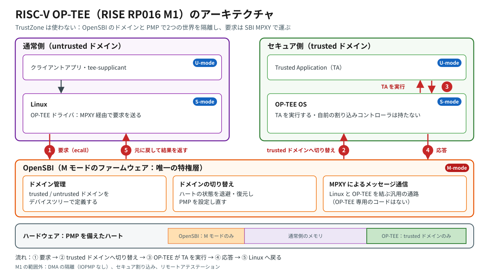
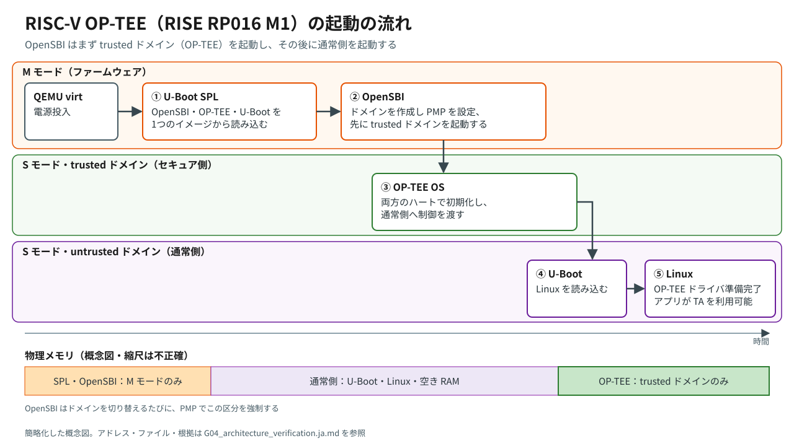

# QEMU での RISC-V OP-TEE — RISE RP016 M1（と後続の構成）の再現

RISE の **riscv-optee** のスタック（OpenSBI + OP-TEE OS + U-Boot + Linux を Buildroot でビルドするもの）を、QEMU（`riscv64 virt`）で `xtest` まで実行した、第三者による証拠に基づく再現です。このリポジトリのすべての主張は、スクリプトとマスク済みのログで裏付けています。

English: [README.md](README.md)

> **範囲と免責**：これは第三者による再現であり、RISE、Andes、RISCstar とは関係ありません。実行したのは QEMU だけで、2026-11-06 に固定した commit を使っています。再現したのはソースであって、バイナリの完全一致ではありません。結果は*この*再現についてのものであり、上流のプロジェクト自身の環境についての主張ではありません。

## 結果の一覧

| Gate | 内容 | 結果 | 作業記録 |
|---|---|---|---|
| G00 | ホストの基準確認 | 条件付き PASS（最初のログが、ログの安全策の導入より前のため） | [EN](docs/G00_host_baseline.md) / [JA](docs/G00_host_baseline.ja.md) |
| G01 | ソースと固定 | PASS：7つのコンポーネントを commit の SHA で固定 | [EN](docs/G01_source_pinning.md) / [JA](docs/G01_source_pinning.ja.md) |
| G02 | Buildroot のビルド | PASS：固定した commit でビルドし、検証した | [EN](docs/G02_buildroot_build.md) / [JA](docs/G02_buildroot_build.ja.md) |
| G03 | 起動、optee_examples、xtest（RP016 M1） | 例外付きの完了：xtest は 110 / 111 | [EN](docs/G03_qemu_boot_xtest.md) / [JA](docs/G03_qemu_boot_xtest.ja.md) |
| G04 | アーキテクチャの検証と図 | 完了 | [EN](docs/G04_architecture_verification.md) / [JA](docs/G04_architecture_verification.ja.md) |
| G05a | 実行時の PMP による隔離、ベアメタルアプリ | 例外付きの完了：隔離を実証 | [EN](docs/G05a_isolation_demo.md) / [JA](docs/G05a_isolation_demo.ja.md) |
| G05b | RP016 M2（APLIC）と M3（VIRQ）の割り込み | PASS | [EN](docs/G05b_interrupts_m2_m3.md) / [JA](docs/G05b_interrupts_m2_m3.ja.md) |
| G05c | Andes v9 と RISE RP022 M8 を M1 と比較 | v9：PASS（xtest 112 / 112）。M8：PMP の分割はあるが TA が失敗。原因は確定 | [EN](docs/G05c_version_comparison.md) / [JA](docs/G05c_version_comparison.ja.md) |

全体に関わる文書：

- [docs/source-lock.md](docs/source-lock.md)：固定したすべての commit
- [docs/evidence-index.ja.md](docs/evidence-index.ja.md)：主張と証拠の対応
- [docs/known-limitations.ja.md](docs/known-limitations.ja.md)：限界、逸脱、訂正

## 主な発見

1. **RP016 M1 は再現できた。** QEMU 10.1.93 で、U-Boot SPL → OpenSBI v1.6（3つのドメイン）→ 両方のハート上の OP-TEE OS → U-Boot → Linux 6.16.0-rc2 の順に起動する。
   - 引数の要らない5つの `optee_examples` はすべて成功し、`xtest` は111ケース中110件が成功する。
   - 失敗した `regression_1039` は、版の不一致による。optee_test 4.6.0 のテスト用サブキー（RSA-2048）が、OP-TEE OS のスナップショットの既定の鍵（RSA-4096）と合わない。1039.1 は実証済み、1039.2 は強く裏付けられている。
2. **TrustZone は使われていない。**
   - OP-TEE は、OpenSBI の *trusted ドメイン*の中で S モードとして動く。
   - その 16 MiB の領域は、PMP によって untrusted ドメイン（Linux）からのアクセスを拒否される。
   - Linux は SBI の **MPXY** 拡張を通じて OP-TEE に到達する。OpenSBI には OP-TEE 専用のコードが無く、汎用の MPXY ドライバがドメインを切り替える。
3. **隔離は実行時に強制されている。** Linux のユーザー空間や U-Boot から OP-TEE と OpenSBI の領域を読むと、*ロードアクセスフォールト*（`cause 5`。ページフォルトではない）で失敗する。許可されたアドレスは読める。
4. **割り込みの土台は OpenSBI で動いている。**
   - M2 は、UART の割り込みを APLIC を通じて M モードで処理する。
   - M3 は、それを仮想 IRQ として持ち主のドメインに届け、ハートを `domain1 → domain2 → domain1` と切り替える。
   - これらのデモに OP-TEE は加わっていない。
5. **Andes v9 はすべて成功する**（112ケース、35,526のサブテスト、失敗 0件）。regression_1039 は optee_test 4.9.0-rc1 で解消している。
6. **RISE RP022 M8 は、OP-TEE のコアを R-X / R / RW の PMP 領域に分割するが、Trusted Application が1つも起動できない。**
   - ldelf が最初の命令でフォールトする（`cause 1`）。
   - 値を1つだけ変える実験で原因を確定した。コアのデータ領域だけに S/U の実行権限を与えると、すべての TA が再び動く。
   - M8 の公式手順は、公開されていないリポジトリにも依存している。この再現では、承認した代替（optee_test 4.6.0）を使った。

## 図





英語版と PNG は [docs/figures/](docs/figures/) にあります。

## 再現の手順

**ホスト**：Ubuntu 24.04（x86_64）と、Buildroot の通常の依存パッケージ（G00 を参照）。ビルドしたツリーごとに約 31 GB のディスクと、ダウンロード用の容量を見込んでください。長いビルドは `tmux` の中で実行します。すべてのスクリプトは、一般ユーザーで、プロジェクトのルートから実行します。

```bash
git clone <このリポジトリ> RISC-V-OP-TEE-On-QEMU-Reproduction
cd RISC-V-OP-TEE-On-QEMU-Reproduction

bash scripts/gate00_env_check.sh                      # ホストの確認（読み取り専用）
bash scripts/gate01_fetch_sources.sh                  # Buildroot の clone、commit の解決と記録
bash scripts/gate02_build.sh --prepare-only && bash scripts/gate02_build.sh       # M1 のビルド
bash scripts/gate03_boot_xtest.sh --prepare-only && bash scripts/gate03_boot_xtest.sh   # 起動 + xtest
bash scripts/gate04_inspect_arch.sh                   # アーキテクチャの証拠（読み取り専用）
bash scripts/gate05a_isolation.sh                     # 実行時の隔離のデモ（-snapshot）
bash scripts/gate05b_build.sh m2 && bash scripts/gate05b_build.sh m3            # 別々の作業ツリー
bash scripts/gate05b_test.sh m3 && bash scripts/gate05b_test.sh m2
bash scripts/gate05b_build.sh v9 && bash scripts/gate05b_build.sh m8
bash scripts/gate05c_xtest.sh v9 && bash scripts/gate05c_xtest.sh m8
bash scripts/gate05c_m8_exp.sh                        # 任意：M8 の確定実験
```

補足：

- ほとんどのスクリプトに `--prepare-only` があり、ビルドや起動をせずに確認だけを行えます。
- `gate05b_build.sh` は、既定では 2 並列でビルドします。変えるときは `G05B_JOBS` を設定します。
- G03 より後の起動はすべて、QEMU の `-snapshot` を使い、転送するポートをすべて `127.0.0.1` に限定しています。
- 詳しい手順は、各作業記録に書いてあります。

## リポジトリの構成

```
README.md / README.ja.md
docs/            作業記録（英語 + 日本語）、source-lock、evidence-index、known-limitations
docs/figures/    概念図（SVG + PNG、英語 + 日本語）
scripts/         最後に使った版のスクリプト
logs/gateNN/     マスク済みのログ。大きなログは .gz。as-run/ は以前のログを作った版のスクリプト
```

## マスク処理

ログは書き込みの時点でマスクしています。公開の前に、すべてのファイルを改めて検査しました（G06-1）。

- マスクした値：`<HOME>`、`<USER>`、`<HOST>`、`<IPv4>`、`<IPv6>`、`<MAC>`、`<EMAIL>`、`<TZ>`（タイムゾーン）。
- メールアドレスのマスクは意図的に広くしてあり、`user@<UID>.service` の形の systemd のユニット名や、パッケージの作者のアドレスのような、無害な文字列も置き換えています。
- 大きなログ（`make` の全出力と、xtest の実行時の QEMU の標準出力）は、gzip で圧縮して公開しています。圧縮の前に、ダウンロードの URL のクエリ文字列（期限付きの署名を含む）と、ANSI の色付けのコードを除去しています。
- 原本（マスク前）のログと、内部の Checkpoint は公開していません。

## ライセンス

このリポジトリの内容（スクリプト、文書、図、ログ）には、ライセンスを許諾していません。すべての権利は作者が留保します。なお、GitHub の利用規約により、GitHub 上での閲覧とフォークはできます。

このリポジトリが再現の対象とした上流のソフトウェア（OpenSBI、OP-TEE、U-Boot、Linux、QEMU、Buildroot など）は、ここには含まれておらず、それぞれ元のライセンスに従います。ログには、それらのビルドやコンソールの出力の一部が含まれています。

## 謝辞

再現した成果は、RISE の RISC-V OP-TEE の取り組み（RP016 / RP022）と、その貢献者（Andes、RISCstar ほか）のものです。

- ソース：https://gitlab.com/riseproject/riscv-optee
- ドキュメント：https://riscv-optee-docs.riseproject.dev/
