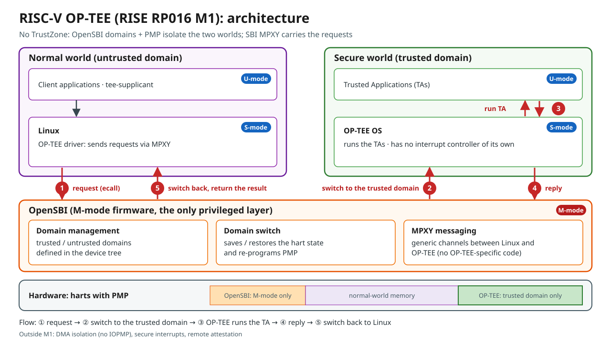
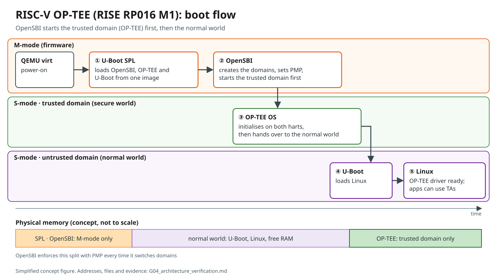

# RISC-V OP-TEE on QEMU — Reproduction of RISE RP016 M1 (and later stacks)

An independent, evidence-based reproduction of the RISE **riscv-optee** stack — OpenSBI + OP-TEE OS + U-Boot + Linux, built with Buildroot — on QEMU (`riscv64 virt`), with `xtest`. Every claim in this repository is backed by a script and a sanitized log.

日本語版: [README.ja.md](README.ja.md)

> **Scope and disclaimer.** This is a third-party reproduction, not affiliated with RISE, Andes or RISCstar. It runs on QEMU only, from commits pinned on 2026-11-06. It reproduces sources, not bit-identical binaries. Results describe *this* reproduction; they are not statements about the upstream projects' own environments.

## Results at a glance

| Gate | What | Result | Record |
|---|---|---|---|
| G00 | Host baseline | Conditional PASS (first log predates the logging safeguards) | [EN](docs/G00_host_baseline.md) / [JA](docs/G00_host_baseline.ja.md) |
| G01 | Sources and pinning | PASS: 7 components pinned to commit SHAs | [EN](docs/G01_source_pinning.md) / [JA](docs/G01_source_pinning.ja.md) |
| G02 | Buildroot build | PASS: built and verified at the pinned commits | [EN](docs/G02_buildroot_build.md) / [JA](docs/G02_buildroot_build.ja.md) |
| G03 | Boot, optee_examples, xtest (RP016 M1) | Completed with one exception: xtest 110 / 111 | [EN](docs/G03_qemu_boot_xtest.md) / [JA](docs/G03_qemu_boot_xtest.ja.md) |
| G04 | Architecture verification, figures | Completed | [EN](docs/G04_architecture_verification.md) / [JA](docs/G04_architecture_verification.ja.md) |
| G05a | Run-time PMP isolation, bare-metal app | Completed with one exception: isolation demonstrated | [EN](docs/G05a_isolation_demo.md) / [JA](docs/G05a_isolation_demo.ja.md) |
| G05b | RP016 M2 (APLIC) and M3 (VIRQ) interrupts | PASS | [EN](docs/G05b_interrupts_m2_m3.md) / [JA](docs/G05b_interrupts_m2_m3.ja.md) |
| G05c | Andes v9 and RISE RP022 M8 compared with M1 | v9: PASS (xtest 112 / 112). M8: PMP split present, TAs fail; cause confirmed | [EN](docs/G05c_version_comparison.md) / [JA](docs/G05c_version_comparison.ja.md) |

Cross-cutting documents:

- [docs/source-lock.md](docs/source-lock.md): every pinned commit.
- [docs/evidence-index.md](docs/evidence-index.md): claim → evidence.
- [docs/known-limitations.md](docs/known-limitations.md): limits, deviations and corrections.

## Key findings

1. **RP016 M1 reproduces.** U-Boot SPL → OpenSBI v1.6 (three domains) → OP-TEE OS on both harts → U-Boot → Linux 6.16.0-rc2 boots on QEMU 10.1.93.
   - All five argument-free `optee_examples` pass, and `xtest` passes 110 of 111 cases.
   - The failure, `regression_1039`, is a version mismatch: the RSA-2048 test subkeys of optee_test 4.6.0 do not match the RSA-4096 default key of the OP-TEE OS snapshot. It is proven for 1039.1 and strongly supported for 1039.2.
2. **There is no TrustZone.**
   - OP-TEE runs in S-mode inside an OpenSBI *trusted domain*.
   - PMP denies its 16 MiB region to the untrusted domain (Linux).
   - Linux reaches OP-TEE through the SBI **MPXY** extension. OpenSBI contains no OP-TEE-specific code: generic MPXY drivers switch the domain.
3. **The isolation is enforced at run time.** Reads from Linux user space and from U-Boot into the OP-TEE and OpenSBI regions fail with *load access faults* (`cause 5`, not a page fault), while a permitted address is readable.
4. **The interrupt groundwork works in OpenSBI.**
   - M2 handles a UART interrupt in M-mode through the APLIC.
   - M3 routes it as a virtual IRQ to its owning domain and switches the hart `domain1 → domain2 → domain1`.
   - OP-TEE takes no part in these demos.
5. **Andes v9 passes everything** (112 cases, 35,526 subtests, 0 failures). regression_1039 is fixed with optee_test 4.9.0-rc1.
6. **RISE RP022 M8 splits the OP-TEE core into R-X / R / RW PMP regions, but no Trusted Application can start.**
   - ldelf faults on its first instruction (`cause 1`).
   - A one-value experiment confirmed the cause: granting S/U-execute to the core data region alone makes every TA work again.
   - The official M8 procedure also depends on a repository that is not publicly accessible; this reproduction used an approved substitute (optee_test 4.6.0).

## Figures





Japanese versions and PNG renderings are in [docs/figures/](docs/figures/).

## Reproduce

**Host.** Ubuntu 24.04 (x86_64) with the usual Buildroot dependencies (see G00). Allow about 31 GB of disk for each built tree, plus downloads. Use `tmux` for long builds. Every script must be run from the project root, as an unprivileged user.

```bash
git clone <this repository> RISC-V-OP-TEE-On-QEMU-Reproduction
cd RISC-V-OP-TEE-On-QEMU-Reproduction

bash scripts/gate00_env_check.sh                      # host check (read-only)
bash scripts/gate01_fetch_sources.sh                  # clone Buildroot, resolve and record commits
bash scripts/gate02_build.sh --prepare-only && bash scripts/gate02_build.sh       # M1 build
bash scripts/gate03_boot_xtest.sh --prepare-only && bash scripts/gate03_boot_xtest.sh   # boot + xtest
bash scripts/gate04_inspect_arch.sh                   # architecture evidence (read-only)
bash scripts/gate05a_isolation.sh                     # run-time isolation demo (-snapshot)
bash scripts/gate05b_build.sh m2 && bash scripts/gate05b_build.sh m3            # separate trees
bash scripts/gate05b_test.sh m3 && bash scripts/gate05b_test.sh m2
bash scripts/gate05b_build.sh v9 && bash scripts/gate05b_build.sh m8
bash scripts/gate05c_xtest.sh v9 && bash scripts/gate05c_xtest.sh m8
bash scripts/gate05c_m8_exp.sh                        # optional: M8 confirmation experiment
```

Notes:

- Most scripts have `--prepare-only`, which runs the checks without building or booting.
- `gate05b_build.sh` uses 2 parallel jobs by default; set `G05B_JOBS` to change this.
- Every boot after G03 uses QEMU `-snapshot` and restricts all forwarded ports to `127.0.0.1`.
- Each record describes its steps in detail.

## Repository layout

```
README.md / README.ja.md
docs/            work records (EN + JA), source-lock, evidence-index, known-limitations
docs/figures/    concept figures (SVG + PNG, EN + JA)
scripts/         the scripts as last used
logs/gateNN/     sanitized logs; large logs as .gz; as-run/ = script versions that produced earlier logs
```

## Sanitization

Logs were masked when they were written. Before publication, every file was scanned again (G06-1).

- Masked values: `<HOME>`, `<USER>`, `<HOST>`, `<IPv4>`, `<IPv6>`, `<MAC>`, `<EMAIL>` and `<TZ>` (time zone).
- The e-mail mask is deliberately broad: it also replaces harmless strings such as systemd unit names of the form `user@<UID>.service` or package authors' addresses.
- Large logs (the full `make` output and the QEMU stdio of xtest runs) are published gzip-compressed. Before compression, the query strings of download URLs (which carry expiring signatures) and the ANSI colour codes were removed.
- Raw (unmasked) logs and internal checkpoints are not published.

## License

No license is granted for the contents of this repository (scripts, documents, figures, logs): all rights are reserved by the author. GitHub's terms of service still allow viewing and forking on GitHub.

The upstream software that this repository reproduces (OpenSBI, OP-TEE, U-Boot, Linux, QEMU, Buildroot and others) is not included here and remains under its own licenses. Excerpts of its build and console output appear in the logs.

## Acknowledgements

The reproduced work belongs to the RISE RISC-V OP-TEE effort (RP016 / RP022) and to its contributors (Andes, RISCstar and others):

- source: https://gitlab.com/riseproject/riscv-optee
- documentation: https://riscv-optee-docs.riseproject.dev/
