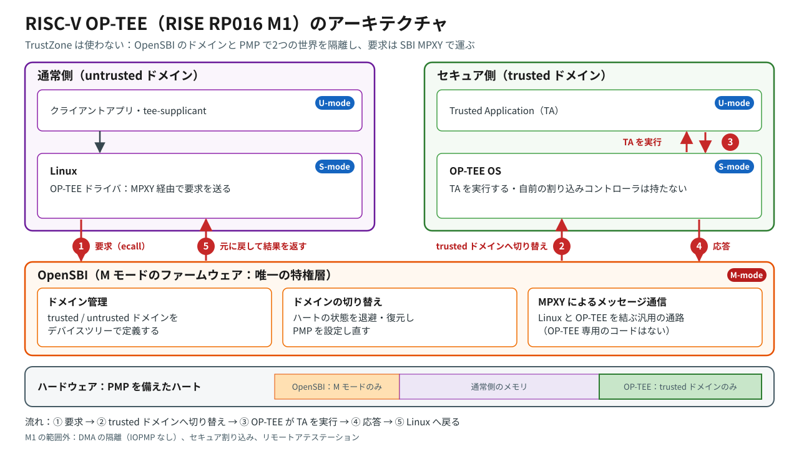
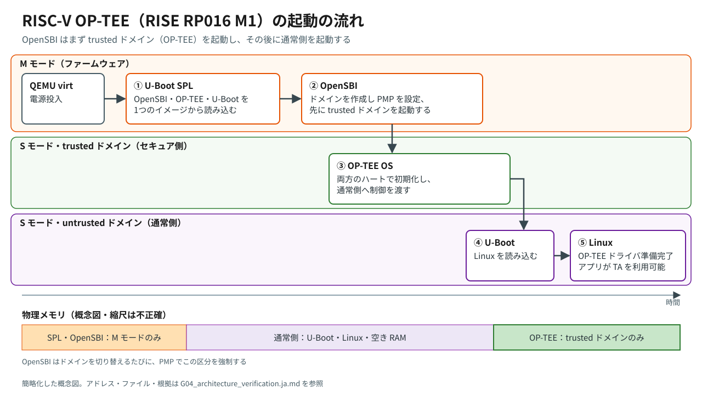

# G04 — アーキテクチャの検証（RISE RP016 M1）

| 項目 | 内容 |
|---|---|
| プロジェクト | RISC-V-OP-TEE-On-QEMU-Reproduction |
| 対象範囲 | 再現した RP016 M1 のビルドのみ（G01 / G02 で固定したソースと、G03 のブートログ） |
| 実施日 | 2026-11-07 |
| スクリプト | `scripts/gate04_inspect_arch.sh`（sha256 `702f6be0…`） |
| 証拠 | `logs/gate04/gate04_inspect_arch_20261107-104416.log`、`gate04_qemu_rv64_virt_domain.decompiled_20261107-104416.dts`、`gate04_u-boot.itb.layout_20261107-104416.dts` |
| 図 | `figures/riscv-optee-m1-architecture-ja.svg`、`figures/riscv-optee-m1-boot-flow-ja.svg`（英語版は `-en.svg`。同名の PNG もあり） |

## 1. 目的

再現した RISC-V OP-TEE（RISE RP016 M1）のアーキテクチャを説明し、2枚の概念図に描いたすべての要素に、ビルドまたはブートログの証拠を対応させる。この再現で示せていないことは、「実証していない」として明示する。英語版は `G04_architecture_verification.md`。

## 2. 手順

```bash
cd ~/projects/RISC-V-OP-TEE-On-QEMU-Reproduction
bash scripts/gate04_inspect_arch.sh
```

スクリプトは読み取り専用で、ビルドも QEMU の起動も行わない。1回の実行で、次のものを集める。

- ドメインを定義した DTS（ソースと、QEMU に渡した DTB の逆コンパイル結果）
- FIT イメージの構成
- U-Boot と OP-TEE のビルド設定
- OpenSBI、OP-TEE OS、Linux、U-Boot のソース上の該当箇所

検索で見つからないことも「結果」として記録し、失敗には数えない。

**以下の表で使う状態**

| 状態 | 意味 |
|---|---|
| **確認済み**（Verified） | 設定、DTS / DTB、FIT イメージ、ソースの該当箇所、またはブートログで直接示されている |
| **裏付けあり**（Supported） | 静的な証拠と矛盾しないが、実行時の挙動は追跡していない |
| **実証していない**（Not demonstrated） | この再現では示していない |

## 3. 証拠

### A. 隔離：OpenSBI のドメインと PMP

| # | 主張 | 証拠 | 状態 |
|---|---|---|---|
| A1 | OpenSBI のドメインは3つ（root、`trusted-domain`、`untrusted-domain`）。 | `arch/riscv/boot/dts/qemu/qemu_rv64_virt_domain.dts` の `opensbi-domains` ノード（133〜164行目）、G03 のブートログのドメイン表示 | 確認済み |
| A2 | OP-TEE の領域 `0xF100_0000`〜`0xF1FF_FFFF`（16 MiB）には `untrusted-domain` からアクセスできず、`trusted-domain` は全メモリにアクセスできる。 | DTS：`tmem` 領域（base `0xF1000000`、order 24）。`untrusted-domain` は `regions = <&tmem 0x0>, <&allmem 0x3f>`、`trusted-domain` は `regions = <&allmem 0x3f>`。G03 のブートログ：`Domain2 Region03 0xf1000000-0xf1ffffff M: () S/U: ()` | 確認済み（設定） |
| A3 | 両方のハートが `trusted-domain` で起動するため、OP-TEE が先に動く。 | DTS：`cpu@0` と `cpu@1` に `opensbi-domain = <&tdomain>`（47行目、75行目）。ブートログ：`Domain1 HARTs : 0*,1*` | 確認済み（設定） |
| A4 | HARTs の表示の `*` は、そのドメインに現在割り当てられているハートを示す。 | A3 と矛盾しない。表示処理のソースそのものは取得していない | 裏付けあり |
| A5 | OpenSBI は、起動時とドメインを切り替えるたびに、その時点のドメインの領域から PMP を設定する。 | `sbi_hart_pmp_configure()` は `lib/sbi/sbi_init.c`（390、469、490行目）と `lib/sbi/sbi_domain_context.c:122` から呼ばれ、`lib/sbi/sbi_hart.c:560` に実装がある。ブートログ：`PMP Count : 16` | 確認済み（ソースの該当箇所） |
| A6 | 実行時に、Linux から OP-TEE の領域へのアクセスを PMP が実際に拒否する。 | G04 では試していない。**後に G05a で実証した**：Linux のユーザー空間から OP-TEE と OpenSBI の領域を読むと `cause 5`（ロードアクセスフォールト）で失敗し、許可されたアドレスは読める | G05a で確認済み |
| A7 | ハート以外のバスマスタ（DMA）も隔離される。 | PMP が検査するのはハートからのアクセスだけで、このビルドには IOPMP がない | 実証していない |

### B. 切り替えと通信（Arm で SMC が担う役割）

| # | 主張 | 証拠 | 状態 |
|---|---|---|---|
| B1 | OpenSBI には OP-TEE 専用のコードがない。 | `lib`、`platform`、`include`、`firmware` に対する `git grep -i optee` で一致なし | 確認済み |
| B2 | 通信には SBI の MPXY 拡張（EID `0x4D505859`）を使う。 | `include/sbi/sbi_ecall_interface.h:40`、`lib/sbi/sbi_mpxy.c`、`lib/sbi/sbi_ecall_mpxy.c` | 確認済み |
| B3 | MPXY の「MM」チャネル 0 / 1（ハートごとに1つ）は `trusted-domain` に結び付いており、これに入るとハートがそのドメインへ切り替わる。 | DTS の `rpmi_mm_0` / `rpmi_mm_1`：`compatible = "riscv,sbi-mpxy-mm"`、`opensbi-domain-instance = <&tdomain>`、担当ハート 0 / 1。`lib/utils/mpxy/fdt_mpxy_mm.c:99` が `sbi_domain_context_enter()` を呼ぶ | 確認済み（設定とソースの該当箇所） |
| B4 | MPXY の「reqfwd」チャネル `0x10` / `0x11` が要求を OP-TEE へ転送し、完了時に trusted ドメインを抜ける。 | DTS の `rpmi_reqfwd_0` / `rpmi_reqfwd_1`（`riscv,sbi-mpxy-reqfwd`）。`lib/utils/mpxy/fdt_mpxy_reqfwd.c:175` が `sbi_domain_context_exit()` を呼ぶ | 確認済み（設定とソースの該当箇所） |
| B5 | Linux は SMC 方式ではなく、MPXY 経由で OP-TEE に到達する。 | `drivers/tee/optee/mpxy_sbi.c` がビルドされ（`mpxy_sbi.o` あり）、`smc_abi.c` はビルドされていない。`drivers/mailbox/riscv-sbi-mpxy-mbox.c` がビルドされている。`CONFIG_OPTEE=y`、`CONFIG_RISCV_SBI_MPXY_MBOX=y` | 確認済み（ビルド結果） |
| B6 | OP-TEE の DT ノードは、Linux に2つの MPXY チャネルを示している。 | DTS の `firmware/optee`：`compatible = "linaro,optee-tz"`、`mboxes = <&mpxy_mbox 0x00 0x00>, <&mpxy_mbox 0x01 0x00>`。旧来の `method = "smc"` プロパティも残っている（E1 を参照） | 確認済み |
| B7 | OP-TEE は MPXY のクライアントとして動き、要求を RPMI の「要求転送（request forwarding）」メッセージとして受け取る。 | `core/arch/riscv/kernel/sbi_mpxy.c` が `SET_SHMEM`（79行目）、`READ_ATTRS`（114行目）、`SEND_MSG_WITH_RESP`（141行目）を発行する。`core/arch/riscv/include/rpmi_msgprot.h` に `rpmi_reqfwd_retrieve_current_message_req/resp` が定義されている | 確認済み（ソースの該当箇所） |
| B8 | 呼び出しの順序は、Linux → MPXY → MM チャネル → コンテキストに入る → OP-TEE が転送された要求を取得 → TA → reqfwd → コンテキストを抜ける → Linux。 | B3〜B7 から導かれる | 裏付けあり（実行時には追跡していない） |

### C. 起動の流れ

| # | 主張 | 証拠 | 状態 |
|---|---|---|---|
| C1 | QEMU が U-Boot SPL を起動し（`-bios`）、QEMU のローダーが FIT イメージを `0x8020_0000` に置く。 | QEMU のコマンドライン（G03）。U-Boot：`CONFIG_SPL_LOAD_FIT_ADDRESS=0x80200000`、`CONFIG_SPL_RAM_DEVICE=y` | 確認済み |
| C2 | U-Boot SPL は M モードで `0x8000_0000` から動く。 | `CONFIG_SPL_TEXT_BASE=0x80000000`、`CONFIG_SPL_RISCV_MMODE=y` | 確認済み |
| C3 | FIT イメージは、ファームウェアとして OpenSBI を選び、U-Boot と OP-TEE を読み込む。 | FIT の `conf-1`：`firmware = "opensbi"`（読み込み先・実行開始 `0x80100000`）、`loadables = "uboot"`（`0x81200000`）、`"tee"`（`0xf1000000`）。`CONFIG_SPL_OPENSBI_LOAD_ADDR=0x80100000`、`CONFIG_SPL_OPTEE_LOAD_ADDR=0xf1000000` | 確認済み |
| C4 | OP-TEE は S モードで動き、M モードのセキュアモニタは OpenSBI が担う。 | `CFG_RISCV_S_MODE=y`、`CFG_RISCV_M_MODE=n`、`CFG_RISCV_WITH_M_MODE_SM=y`、`CFG_RISCV_SBI=y`。`CFG_TDDRAM_START=0xF1000000`、`CFG_TDDRAM_SIZE=0x01000000`。2コア、2スレッド。`CFG_CORE_ASLR=y`。`CFG_RISCV_MMU_MODE=39` | 確認済み |
| C5 | ドメインの開始アドレスはイメージと一致する：`trusted-domain` は `CFG_TDDRAM_START` から、`untrusted-domain` は U-Boot の `CONFIG_TEXT_BASE` から始まる。 | DTS の `next-addr`（152行目、161行目。コメントにこれらの設定名が書かれている）。`CONFIG_TEXT_BASE=0x81200000` | 確認済み |
| C6 | OP-TEE の初期化後、制御は `untrusted-domain`（ハート 0 上の U-Boot）へ移る。 | ドメインの設定（A3、`boot-hart = <&cpu0>`）とブートログの順序。受け渡しの仕組みそのものは追跡していない | 裏付けあり |

### D. 割り込み

| # | 主張 | 証拠 | 状態 |
|---|---|---|---|
| D1 | このビルドの OP-TEE は、割り込みコントローラのドライバを持たない。 | `CFG_RISCV_PLIC=n`、`CFG_RISCV_APLIC=n`、`CFG_RISCV_APLIC_MSI=n`、`CFG_RISCV_IMSIC=n` | 確認済み |
| D2 | OP-TEE の実行中に外部（foreign）割り込みが来ると、OP-TEE は通常側へ抜ける。 | `core/arch/riscv/kernel/thread_rv.S:116〜129`（`thread_foreign_interrupt_handler` への分岐）、`thread_arch.c` の `THREAD_FLAGS_EXIT_ON_FOREIGN_INTR` | 確認済み（ソースの該当箇所） |
| D3 | この構成で、どの割り込みが native で、どれが foreign か。 | 取得していない | 実証していない |

### E. G03 のブートログに出た2件の警告

**E1 — U-Boot：`OP-TEE api uid mismatch`**（裏付けあり）

- **失敗している箇所**：`drivers/tee/optee/core.c:827〜829`。`optee_probe()` は、`is_optee_api()` が期待どおりの API UID を返さないと処理を止める。
- **UID の値は原因ではない**：UID の定数は両側で一致している（`OPTEE_MSG_UID_0` = `0x384fb3e0` など）。RISC-V 版 OP-TEE は `core/arch/riscv/tee/entry_fast.c:291〜294` で、まさにこの値を返す。
- **原因は通信経路と考えられる**：
  - U-Boot の OP-TEE ドライバには、`method = "smc"` で選ばれる SMC 方式の呼び出し経路しかなく、MPXY のコードを持たない。
  - OpenSBI には OP-TEE 専用の処理がない（B1）。
  - この設計では、OP-TEE には MPXY 経由でしか到達できない（B3〜B5）。
  - U-Boot のコミットは Andes の `dev-optee-mpxy-v5` と同一で、OpenSBI、OP-TEE OS、Linux は `-v6` と同一である。
- **取得していないこと**：U-Boot が実際に発行する SBI 呼び出しの内容。
- **影響**：U-Boot 自身は OP-TEE を使えない（例：`CONFIG_OPTEE_TA_AVB` で有効になっている AVB の TA）。Linux には影響しない。

**E2 — OP-TEE：`CPU node does not have 'reg' property`**（確認済み・無害）

- **発生元**：`boot_primary_init_core_ids()`（`core/arch/riscv/kernel/boot.c:168〜202`）は、`/cpus` の子ノードをすべて順に調べる。この DTS の `/cpus` には、`cpu@0`（reg 0）と `cpu@1`（reg 1）に加えて、`reg` を持たない `cpu-map` がある。このメッセージは `cpu-map` について出ており、処理はそのまま続く。
- **無害である理由**：2つのハート ID は正しく集められ、`assert(i == CFG_TEE_CORE_NB_CORE)` も成立している（このビルドは `DEBUG=1`）。ブートログでも、両方のハートの初期化が完了している。

### F. 背景

- **当初の設計目標と実装の違い**：RISE wiki は当初、ドメインコンテキストの切り替えと MPXY（旧称 RPXY）拡張を使って、「OpenSBI に OP-TEE SPD を実装する」ことを目標にしていた。再現した M1 のコードでは、OpenSBI に OP-TEE 専用のディスパッチャは存在せず、その役割は汎用の MPXY「MM」ドライバと「reqfwd」ドライバが担っている（B1、B3、B4）。
- **共有メモリ**：RISE wiki のメモリマップには、`0xF200_0000` に静的な共有メモリ（2 MiB）が記載されている。このビルドは `CFG_CORE_RESERVED_SHM=n` で、Linux も「dynamic shared memory is enabled」と表示しているため、この静的な領域は使われていない。
- **補足**：RISC-V のファームウェアに関する議論で、OS と、OpenSBI の別ドメインとして動く TEE との間の、Management Mode（MM）通信用の RPMI サービスグループが提案されている。`riscv,sbi-mpxy-mm` という名前の由来はこれと考えられるが、ソース上では確認していない。
- **2026年9月の RFC**（外部監査で挙げられた OP-TEE メーリングリストの RFC）は見つけられなかったため、本記録では用いない。

## 4. Arm TrustZone を知っている読者向けの対応表

この対応表は、各部品の位置付けをつかむためのものである。仕組みそのものは異なる。

| Arm TrustZone（Cortex-A） | 再現した RISC-V OP-TEE（RP016 M1） |
|---|---|
| EL3 のセキュアモニタ（TF-A） | M モードの OpenSBI v1.6 |
| `SMC` 命令 + TF-A 内の OP-TEE SPD | SBI MPXY 拡張への `ecall` + 汎用の MPXY MM / reqfwd ドライバ（OP-TEE 専用コードなし） |
| ワールドの切り替え | OpenSBI のドメインコンテキスト切り替え（S モードの状態の退避・復元 + PMP の再設定） |
| NS ビット、TZASC / TZC | PMP で強制される OpenSBI ドメインのメモリ領域（M1 には IOPMP / WorldGuard なし） |
| セキュア割り込み（FIQ / GIC のグループ） | なし：OP-TEE は割り込みコントローラを持たず、foreign 割り込みで Linux へ抜ける |
| S-EL1 の OP-TEE OS | `trusted-domain` 内の S モードの OP-TEE OS |

## 5. 図

2枚の図は、スライド用（16:9）に簡略化した概念図である。システムの構成と動作の流れを説明するためのもので、ファイル名、アドレス、証拠は3章の表にまとめている。





英語版は `figures/riscv-optee-m1-architecture-en.svg` と `figures/riscv-optee-m1-boot-flow-en.svg`。SVG を貼り込めないスライドツール向けに、同じ名前の PNG も用意している。

どちらの図も、本プロジェクトのためのオリジナルの作図である。図のすべての要素は、3章で「確認済み」または「裏付けあり」とした項目に対応している。要求の流れ①〜⑤は B8（裏付けあり）に、OP-TEE から通常側への制御の受け渡しは C6（裏付けあり）に対応する。

## 6. この再現で実証していないこと

- ~~PMP による隔離の実行時の強制~~：その後 G05a で実証した（`G05a_isolation_demo.ja.md`）。*（公開に向けて更新。）*
- DMA の隔離（M1 には IOPMP がなく、PMP が対象とするのはハートからのアクセスだけ）。
- セキュア割り込み、リモートアテステーション（`regression_1037` は内部でスキップ）、fTPM（`regression_1041` は内部でスキップ）。
- U-Boot からの OP-TEE の利用（E1）。
- RP016 の後続の成果：APLIC の M モード有線割り込み（M2）、VIRQ（M3）、WorldGuard（M5）。これらは M1 のビルドには含まれない。

## 7. まとめ

再現した RP016 M1 の構成では、OP-TEE OS は OpenSBI の `trusted-domain` の中で S モードとして動く。このドメインは `0xF100_0000` からの 16 MiB の領域を持ち、U-Boot と Linux が動く `untrusted-domain` からはアクセスできない。この制限は、ドメインを切り替えるたびに PMP によって適用される。

Linux は SBI の MPXY 拡張を通じて OP-TEE と通信する。ハートごとの「MM」チャネルがハートを trusted ドメインへ切り替え、「reqfwd」チャネルが転送された要求とその完了を運ぶ。OpenSBI 自体には、OP-TEE 専用のコードはない。

ブートログに出た2件の警告は、どちらも説明できた。

- U-Boot は SMC 方式の経路しか持たないため、OP-TEE に到達できない。
- `reg` のメッセージは、`cpu-map` ノードによる無害なものである。

DMA の保護とアテステーションは、この再現で示せる範囲の外にある。G04 の時点で未確認だった隔離の実行時の強制は、その後 G05a で実証した。
