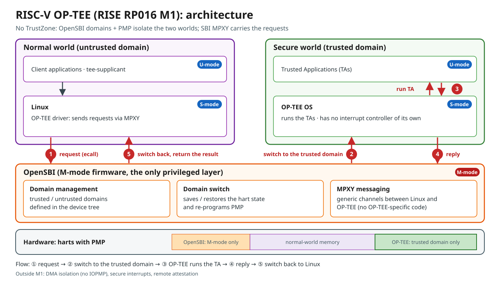
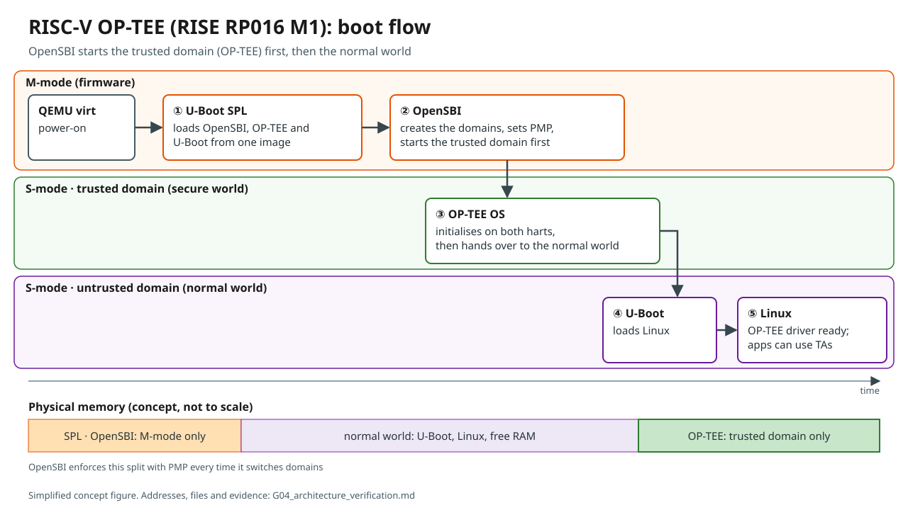

# G04 — Architecture Verification (RISE RP016 M1)

| Item | Value |
|---|---|
| Project | RISC-V-OP-TEE-On-QEMU-Reproduction |
| Scope | The reproduced RP016 M1 build only: pinned sources (G01/G02) and the G03 boot log |
| Date | 2026-11-07 |
| Script | `scripts/gate04_inspect_arch.sh` (sha256 `702f6be0…`) |
| Evidence | `logs/gate04/gate04_inspect_arch_20261107-104416.log`, `gate04_qemu_rv64_virt_domain.decompiled_20261107-104416.dts`, `gate04_u-boot.itb.layout_20261107-104416.dts` |
| Figures | `figures/riscv-optee-m1-architecture-en.svg`, `figures/riscv-optee-m1-boot-flow-en.svg` (Japanese: `-ja.svg`; PNG versions alongside) |

## 1. Goal

Describe the architecture of RISC-V OP-TEE as reproduced (RISE RP016 M1), and back every element of the two concept figures with evidence from the build or from the boot log. Anything that this reproduction does not show is listed explicitly as not demonstrated. A Japanese version of this document is available as `G04_architecture_verification.ja.md`.

## 2. Steps

```bash
cd ~/projects/RISC-V-OP-TEE-On-QEMU-Reproduction
bash scripts/gate04_inspect_arch.sh
```

The script is read-only. It builds nothing and starts no QEMU. In one run, it collects:

- the domain DTS (both the source and the DTB passed to QEMU, decompiled);
- the FIT image layout;
- the U-Boot and OP-TEE build configuration;
- code locations in OpenSBI, OP-TEE OS, Linux and U-Boot.

A search without a match is recorded as a result, not as a failure.

**Status labels used below**

| Label | Meaning |
|---|---|
| **Verified** | Shown directly by the configuration, the DTS / DTB, the FIT image, a code location, or the boot log |
| **Supported** | Consistent with static evidence, but the run-time behaviour was not traced |
| **Not demonstrated** | Not shown by this reproduction |

## 3. Evidence

### A. Isolation: OpenSBI domains and PMP

| # | Claim | Evidence | Status |
|---|---|---|---|
| A1 | There are three OpenSBI domains: root, `trusted-domain` and `untrusted-domain`. | `opensbi-domains` node in `arch/riscv/boot/dts/qemu/qemu_rv64_virt_domain.dts` (lines 133–164); domain report in the G03 boot log | Verified |
| A2 | The OP-TEE region `0xF100_0000`–`0xF1FF_FFFF` (16 MiB) is denied to `untrusted-domain`, while `trusted-domain` gets access to all memory. | DTS: `tmem` region with base `0xF1000000` and order 24; `untrusted-domain` has `regions = <&tmem 0x0>, <&allmem 0x3f>`, `trusted-domain` has `regions = <&allmem 0x3f>`. G03 boot log: `Domain2 Region03 0xf1000000-0xf1ffffff M: () S/U: ()` | Verified (configuration) |
| A3 | Both harts start in `trusted-domain`, so OP-TEE runs first. | DTS: `cpu@0` and `cpu@1` have `opensbi-domain = <&tdomain>` (lines 47 and 75). Boot log: `Domain1 HARTs : 0*,1*` | Verified (configuration) |
| A4 | The `*` in the HARTs line marks harts currently assigned to the domain. | Consistent with A3; the print code itself was not captured | Supported |
| A5 | OpenSBI programs PMP from the regions of the active domain, at boot and at every domain context switch. | `sbi_hart_pmp_configure()` is called from `lib/sbi/sbi_init.c` (lines 390, 469, 490) and from `lib/sbi/sbi_domain_context.c:122`. It is implemented in `lib/sbi/sbi_hart.c:560`. The boot log reports `PMP Count : 16`. | Verified (code locations) |
| A6 | PMP actually denies an access from Linux into the OP-TEE region at run time. | Not tested in G04. **Demonstrated later in G05a**: reads from Linux user space into the OP-TEE and OpenSBI regions fail with `cause 5` (load access fault), while a permitted address is readable | Verified in G05a |
| A7 | Bus masters other than the harts (DMA) are isolated. | PMP checks hart accesses only, and this build has no IOPMP | Not demonstrated |

### B. Switching and communication (the role that SMC plays on Arm)

| # | Claim | Evidence | Status |
|---|---|---|---|
| B1 | OpenSBI contains no OP-TEE-specific code. | `git grep -i optee` over `lib`, `platform`, `include` and `firmware` finds no match | Verified |
| B2 | Communication uses the SBI MPXY extension (EID `0x4D505859`). | `include/sbi/sbi_ecall_interface.h:40`; `lib/sbi/sbi_mpxy.c`, `lib/sbi/sbi_ecall_mpxy.c` | Verified |
| B3 | MPXY "MM" channels 0 and 1 (one per hart) are bound to `trusted-domain`, and entering one switches the hart into that domain. | DTS `rpmi_mm_0` / `rpmi_mm_1`: `compatible = "riscv,sbi-mpxy-mm"`, `opensbi-domain-instance = <&tdomain>`, owner hart 0 / 1. `lib/utils/mpxy/fdt_mpxy_mm.c:99` calls `sbi_domain_context_enter()` | Verified (configuration and code location) |
| B4 | MPXY "reqfwd" channels `0x10` / `0x11` forward requests to OP-TEE; completion leaves the trusted domain. | DTS `rpmi_reqfwd_0` / `rpmi_reqfwd_1` (`riscv,sbi-mpxy-reqfwd`). `lib/utils/mpxy/fdt_mpxy_reqfwd.c:175` calls `sbi_domain_context_exit()` | Verified (configuration and code location) |
| B5 | Linux reaches OP-TEE through MPXY, not through an SMC-style call. | `drivers/tee/optee/mpxy_sbi.c` was built (`mpxy_sbi.o` exists); `smc_abi.c` was not built. `drivers/mailbox/riscv-sbi-mpxy-mbox.c` was built. `CONFIG_OPTEE=y`, `CONFIG_RISCV_SBI_MPXY_MBOX=y` | Verified (build output) |
| B6 | The OP-TEE DT node points Linux to the two MPXY channels. | DTS `firmware/optee`: `compatible = "linaro,optee-tz"`, `mboxes = <&mpxy_mbox 0x00 0x00>, <&mpxy_mbox 0x01 0x00>`. A legacy `method = "smc"` property is still present (see E1). | Verified |
| B7 | OP-TEE uses MPXY as a client and receives requests as RPMI request-forwarding messages. | `core/arch/riscv/kernel/sbi_mpxy.c` issues `SET_SHMEM` (line 79), `READ_ATTRS` (line 114) and `SEND_MSG_WITH_RESP` (line 141); `core/arch/riscv/include/rpmi_msgprot.h` defines `rpmi_reqfwd_retrieve_current_message_req/resp` | Verified (code locations) |
| B8 | The call order is: Linux → MPXY → MM channel → context enter → OP-TEE fetches the forwarded request → TA → reqfwd → context exit → Linux. | Follows from B3–B7 | Supported (not traced at run time) |

### C. Boot chain

| # | Claim | Evidence | Status |
|---|---|---|---|
| C1 | QEMU starts U-Boot SPL (`-bios`), and the QEMU loader places the FIT image at `0x8020_0000`. | QEMU command line (G03). U-Boot: `CONFIG_SPL_LOAD_FIT_ADDRESS=0x80200000`, `CONFIG_SPL_RAM_DEVICE=y` | Verified |
| C2 | U-Boot SPL runs in M-mode at `0x8000_0000`. | `CONFIG_SPL_TEXT_BASE=0x80000000`, `CONFIG_SPL_RISCV_MMODE=y` | Verified |
| C3 | The FIT image selects OpenSBI as firmware and loads U-Boot and OP-TEE. | FIT `conf-1`: `firmware = "opensbi"` (load / entry `0x80100000`), `loadables = "uboot"` (`0x81200000`), `"tee"` (`0xf1000000`). `CONFIG_SPL_OPENSBI_LOAD_ADDR=0x80100000`, `CONFIG_SPL_OPTEE_LOAD_ADDR=0xf1000000` | Verified |
| C4 | OP-TEE runs in S-mode, with OpenSBI as the M-mode secure monitor. | `CFG_RISCV_S_MODE=y`, `CFG_RISCV_M_MODE=n`, `CFG_RISCV_WITH_M_MODE_SM=y`, `CFG_RISCV_SBI=y`; `CFG_TDDRAM_START=0xF1000000`, `CFG_TDDRAM_SIZE=0x01000000`; 2 cores, 2 threads; `CFG_CORE_ASLR=y`; `CFG_RISCV_MMU_MODE=39` | Verified |
| C5 | The domain entry points match the images: `trusted-domain` enters at `CFG_TDDRAM_START`, and `untrusted-domain` enters at U-Boot's `CONFIG_TEXT_BASE`. | DTS `next-addr` values (lines 152 and 161, with comments naming exactly these settings); `CONFIG_TEXT_BASE=0x81200000` | Verified |
| C6 | After OP-TEE initialises, control passes to `untrusted-domain` (U-Boot on hart 0). | Domain setup (A3, `boot-hart = <&cpu0>`) and the boot log order; the hand-off mechanism was not traced | Supported |

### D. Interrupts

| # | Claim | Evidence | Status |
|---|---|---|---|
| D1 | OP-TEE has no interrupt-controller driver in this build. | `CFG_RISCV_PLIC=n`, `CFG_RISCV_APLIC=n`, `CFG_RISCV_APLIC_MSI=n`, `CFG_RISCV_IMSIC=n` | Verified |
| D2 | A foreign interrupt taken in OP-TEE makes OP-TEE exit to the normal world. | `core/arch/riscv/kernel/thread_rv.S:116–129` (dispatch to `thread_foreign_interrupt_handler`); `THREAD_FLAGS_EXIT_ON_FOREIGN_INTR` in `thread_arch.c` | Verified (code location) |
| D3 | Which interrupt sources are "native" and which are "foreign" in this configuration. | Not captured | Not demonstrated |

### E. The two warnings from the G03 boot log

**E1 — U-Boot: `OP-TEE api uid mismatch`** (Supported)

- **Where it fails**: `drivers/tee/optee/core.c:827–829`. `optee_probe()` stops when `is_optee_api()` does not return the expected API UID.
- **The UID values are not the cause**: the UID constants agree on both sides (`OPTEE_MSG_UID_0` = `0x384fb3e0`, …). The RISC-V OP-TEE returns exactly these values in `core/arch/riscv/tee/entry_fast.c:291–294`.
- **The likely cause is the transport**:
  - U-Boot's OP-TEE driver only has an SMC-style invoke path, selected by `method = "smc"`. It contains no MPXY code.
  - OpenSBI contains no OP-TEE-specific handler (B1).
  - In this design, OP-TEE is reachable only through MPXY (B3–B5).
  - The U-Boot commit equals Andes' `dev-optee-mpxy-v5`, while OpenSBI, OP-TEE OS and Linux equal `-v6`.
- **What was not captured**: the exact SBI call that U-Boot issues.
- **Impact**: U-Boot itself cannot use OP-TEE (for example, the AVB TA enabled by `CONFIG_OPTEE_TA_AVB`). Linux is not affected.

**E2 — OP-TEE: `CPU node does not have 'reg' property`** (Verified, harmless)

- **Where it comes from**: `boot_primary_init_core_ids()` (`core/arch/riscv/kernel/boot.c:168–202`) walks every child node of `/cpus`. In this DTS, `/cpus` contains `cpu@0` (reg 0), `cpu@1` (reg 1) and `cpu-map`, which has no `reg`. The message is printed for `cpu-map`, and the loop continues.
- **Why it is harmless**: both hart IDs are still collected, `assert(i == CFG_TEE_CORE_NB_CORE)` holds (this is a `DEBUG=1` build), and the boot log shows both harts initialised.

### F. Context

- **Design target versus implementation**: the RISE wiki originally aimed to "support OP-TEE SPD in OpenSBI" using domain context switching and the MPXY (formerly RPXY) extension. In the reproduced M1 code, there is no OP-TEE-specific dispatcher in OpenSBI. The role is played by the generic MPXY "MM" and "reqfwd" drivers (B1, B3, B4).
- **Shared memory**: the RISE wiki memory map lists a static shared-memory region at `0xF200_0000` (2 MiB). This build has `CFG_CORE_RESERVED_SHM=n`, and Linux reports "dynamic shared memory is enabled", so the static region is not used here.
- **Background**: a RISC-V firmware discussion proposes an RPMI service group for management-mode (MM) communication between an OS and a TEE running as a separate OpenSBI domain. This is the likely origin of the `riscv,sbi-mpxy-mm` naming. This interpretation was not confirmed in the source.
- **The RFC of September 2026** on the OP-TEE mailing list (named in an external audit) could not be located; it is not used here.

## 4. Orientation for readers who know Arm TrustZone

This analogy only helps to place the components. The mechanisms are different.

| Arm TrustZone (Cortex-A) | RISC-V OP-TEE as reproduced (RP016 M1) |
|---|---|
| EL3 secure monitor (TF-A) | M-mode OpenSBI v1.6 |
| `SMC` instruction + OP-TEE SPD in TF-A | `ecall` to the SBI MPXY extension + generic MPXY MM / reqfwd drivers (no OP-TEE-specific code) |
| World switch | OpenSBI domain context switch (S-mode context save / restore + PMP re-programming) |
| NS bit, TZASC / TZC | OpenSBI domain memory regions enforced by PMP (no IOPMP / WorldGuard in M1) |
| Secure interrupts (FIQ / GIC groups) | None: OP-TEE has no interrupt controller; foreign interrupts cause an exit to Linux |
| S-EL1 OP-TEE OS | S-mode OP-TEE OS in `trusted-domain` |

## 5. Figures

The two figures are simplified concept figures (16:9, for slides). They explain how the system is organised and how it runs; file names, addresses and evidence are kept in section 3 instead.





Japanese versions: `figures/riscv-optee-m1-architecture-ja.svg` and `figures/riscv-optee-m1-boot-flow-ja.svg`. PNG renderings with the same names are provided for slide tools that cannot import SVG.

Both figures are original drawings for this project. Every element in them corresponds to an entry with status Verified or Supported in section 3. The request flow ①–⑤ corresponds to B8 (Supported), and the hand-over from OP-TEE to the normal world corresponds to C6 (Supported).

## 6. Not demonstrated by this reproduction

- ~~Run-time enforcement of the PMP isolation~~: demonstrated afterwards in G05a (`G05a_isolation_demo.md`). *(Updated for publication.)*
- DMA isolation (no IOPMP in M1; PMP covers hart accesses only).
- Secure interrupts, remote attestation (`regression_1037` was skipped internally) and fTPM (`regression_1041` was skipped internally).
- U-Boot's use of OP-TEE (E1).
- Later RP016 work: APLIC M-mode wired interrupts (M2), VIRQ (M3) and WorldGuard (M5). These features are not part of the M1 build.

## 7. Summary

In the reproduced RP016 M1 stack, OP-TEE OS runs in S-mode inside an OpenSBI `trusted-domain`. That domain owns a 16 MiB region at `0xF100_0000`, which the `untrusted-domain` running U-Boot and Linux may not access; the restriction is applied through PMP on every domain switch.

Linux talks to OP-TEE through the SBI MPXY extension. Per-hart "MM" channels switch the hart into the trusted domain, and "reqfwd" channels carry the forwarded request and its completion. OpenSBI itself contains no OP-TEE-specific code.

Both boot-log warnings are explained:

- U-Boot cannot reach OP-TEE, because it only has the SMC-style path.
- The `reg` message is a harmless artefact of the `cpu-map` node.

DMA protection and attestation are outside what this reproduction demonstrates. Run-time enforcement of the isolation, open in G04, was demonstrated afterwards in G05a.
